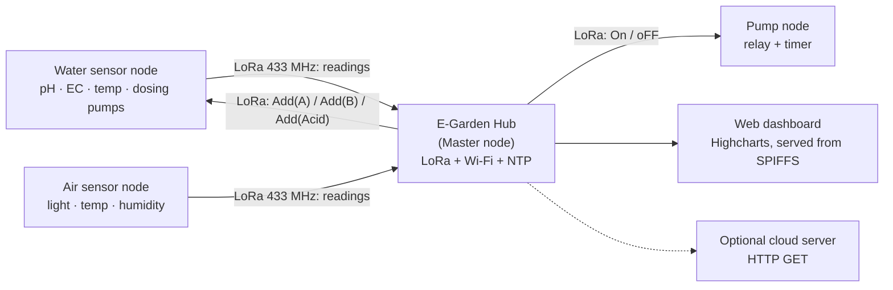

# E-Garden

An automated hydroponic greenhouse controlled over LoRa (433 MHz) with a web dashboard. E-Garden is the group capstone project of a team of 5 students at Chitralada vocational school.

This repository contains the **original code as it was at the end of the project** (file dates Sep 2022 – Feb 2023), tagged `v1-original`. Nothing has been refactored or modernized. The only changes from the original files are the removal of private values (Wi-Fi credentials and the server URL), see [Configuration](#configuration).

## My role

I wrote the ESP32 firmware (controller boxes + LoRa link to the Master box) and part of the web dashboard with one teammate. 5 members in total.

## Credits

E-Garden was a team project of 5 students: 2 on hardware, 1 on the website, and 2 on IoT development (firmware and dashboard: me and one teammate). I only claim the parts listed under *My role*. The hardware and the website were done by the other team members.

Third-party material:

- The form/SPIFFS parts of `Wed_server_F.3.13` and `Wed_server_test_Auto` (the `/get` handler with `inputString` / `inputInt` / `inputFloat`, `readFile` / `writeFile` / `notFound`, and the ESP32/ESP8266 `#ifdef` include block) and the whole of `Dev/web_server/web_server.ino` are adapted from example projects by [Random Nerd Tutorials](https://randomnerdtutorials.com) (Rui Santos). The original examples carry their own terms, see the site.
- Libraries: [arduino-LoRa](https://github.com/sandeepmistry/arduino-LoRa), ESPAsyncWebServer, AsyncTCP, Adafruit AHTX0, BH1750, OneWire, DallasTemperature (all through the Arduino IDE).
- The dashboard pages load [Highcharts](https://www.highcharts.com), Font Awesome and Google Fonts from their CDNs. Check the Highcharts license before any commercial use.

## Nodes

| Node | Role | Sketch |
|---|---|---|
| 1. **E-Garden Hub** (Master node) | LoRa gateway, web dashboard, timing and commands | `Wed_server_F.3.13/` (`LoRa_Master/` earlier) |
| 2. **Water sensor node** | pH, EC, water temperature, nutrient/acid dosing | `LoRa_Water3.2/` |
| 3. **Air sensor node** | Light, air temperature and humidity | `LoRa_Air__v1/` |
| 4. **Pump node** | LoRa-controlled water pump with auto-off timer | `Receive_PUMP_F.1/` |

## Hardware

Common to every node: ESP32 board and a 433 MHz LoRa module (SX127x class, used through arduino-LoRa).

**1. E-Garden Hub (Master node)**
- ESP32 with Wi-Fi (dashboard, NTP time)
- LoRa module: SS 5, RST 15, DIO0 2

**2. Water sensor node**
- RS485 / Modbus pH + temperature sensor
- RS485 / Modbus EC sensor
- RS485 transceiver module (DE 33, RE 32, serial on pins 26/27 at 9600 baud)
- 3 stepper-driven dosing pumps: A (pin 21), B (pin 2), Acid (pin 0); direction 16, enable 4
- LoRa module: SS 5, RST 15, DIO0 17
- Battery voltage measurement through an ADC pin

**3. Air sensor node**
- BH1750 light sensor (I²C)
- AM2305 temperature / humidity sensor (I²C, read with the Adafruit AHTX0 library)
- Battery voltage measurement on ADC pin 36, deep sleep between readings
- LoRa module: SS 5, RST 15, DIO0 2
- DS18B20: its libraries are included in the sketch, but the sensor is not read in the final code

**4. Pump node**
- Relay module on pin 26 switching the water pump
- LoRa module: SS 5, RST 14, DIO0 2

Pins are taken from the final sketches listed above. Earlier snapshots in `Dev/` use different pins and addresses.

## Architecture

- The **water sensor node** reads pH, water temperature and EC over RS485/Modbus, sends them to the Hub, and doses nutrients A, B and acid when the Hub sends `Add(A)`, `Add(B)` or `Add(Acid)`.
- The **air sensor node** measures light, air temperature and humidity, and battery level, then sleeps between readings.
- The **pump node** switches the water pump on `On` and off on `oFF`, with an automatic off timer.
- The **E-Garden Hub** receives the sensor packets, keeps time over NTP, serves the dashboard, and sends commands back to the nodes. One sketch (`LoRa_Master/`) also forwards readings to a cloud server with an HTTP GET.
- **LoRa link**: 433 MHz with a sync word per network (`0xAA` / `0xAB`, depending on the sketch). Packets are plain text, for example a reading is `readingID@address/value1&value2$value3#value4^` and a command is `readingID@address/command&amount$`.
- **Dashboard**: a Highcharts page (`data/index.html`) served by the Hub from SPIFFS, plus static page mockups in `web project/`.

## Repository layout

| Folder | What it is |
|---|---|
| `LoRa_Air__v1/` | Air box firmware |
| `LoRa_Water3.2/` | Water box firmware (pH/EC, dosing pumps) and its dashboard page |
| `Receive_PUMP_F.1/` | Pump box firmware |
| `Wed_server_F.3.13/` | Master box with web server, SPIFFS dashboard (`data/`) and LoRa commands |
| `Wed_server_test_Auto/` | Same as above plus a timed auto-dosing test |
| `LoRa_Master/` | Earlier Master box that forwards readings to a cloud server |
| `time/` | NTP time test |
| `Dev/` | Earlier development snapshot (Oct 2022) of the same boxes |
| `web project/` | Static dashboard page mockups and styles |

Addresses, pins and sync words differ between snapshots, so check the constants at the top of each sketch before flashing.

## Configuration

Wi-Fi credentials (and the cloud server URL for the `LoRa_Master` sketches) are not in the repository. In every sketch folder that has a `secrets.h.example`:

1. Copy `secrets.h.example` to `secrets.h` in the same folder.
2. Fill in your own values. `secrets.h` is git-ignored.

`SERVER_URL` is a placeholder: the original server is private and is not part of this repository. Sensor values are appended to the URL path as `id|temperature|humidity|light|battery`.

## Build and run

Arduino IDE with the **ESP32 board package (arduino-esp32) version 2.0.17**, which is what the original code was built and run with, and the libraries above. For the sketches that have a `data/` folder (the Master box), upload it to the board with the ESP32 sketch data upload tool.

## Notes

- Published as-is as a record of the project. Some sketches contain experimental or commented-out code.
- The team photos that the original `web project/index3.html` page shows are not included, so those images appear broken.
