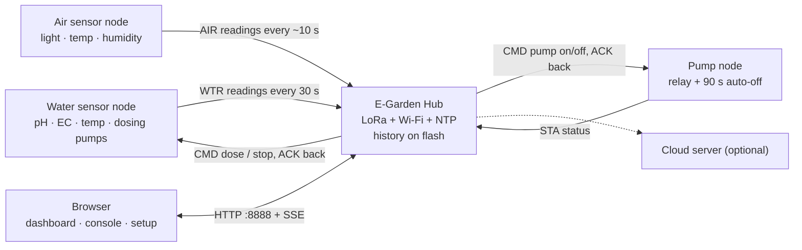

# E-Garden

[](https://github.com/Putinun-te/E-Garden/actions/workflows/build.yml)

An automated hydroponic greenhouse controlled over LoRa (433 MHz) with a web dashboard. E-Garden is the group capstone project of a team of 5 students at Chitralada vocational school (2022–2023).

> **Status: v2 is compile-checked and unit-tested, but has not been run on real hardware.**
> The original code, exactly as it ran at the end of the project (with only the secrets removed), is at tag [`v1-original`](https://github.com/Putinun-te/E-Garden/tree/v1-original). v2 keeps the v1 pins, timings and sensor handling unless a change is listed below, but nobody has flashed it onto the boards yet, because the hardware no longer exists.

## My role

I wrote the ESP32 firmware (controller boxes + LoRa link to the Master box) and part of the web dashboard with one teammate. 5 members in total.

## Credits

E-Garden was a team project of 5 students: 2 on hardware, 1 on the website, and 2 on IoT development (firmware and dashboard: me and one teammate). I only claim the parts listed under *My role*. The hardware and the website were done by the other team members.

- The v1 code (tag `v1-original`) contains form/SPIFFS handling and a DHT web-server sketch adapted from [Random Nerd Tutorials](https://randomnerdtutorials.com) (Rui Santos). That code is not used on this branch.
- Libraries: [arduino-LoRa](https://github.com/sandeepmistry/arduino-LoRa), [ESPAsyncWebServer and AsyncTCP](https://github.com/ESP32Async) (ESP32Async), Adafruit AHTX0, BH1750, Unity (tests).

## Nodes

| Node | Role | Code |
|---|---|---|
| 1. **E-Garden Hub** (Master node) | LoRa gateway, web dashboard and API, pump schedule, commands, history | [`firmware/hub`](firmware/hub) |
| 2. **Water sensor node** | pH, EC and water temperature over RS485/Modbus; runs the dosing pumps | [`firmware/water`](firmware/water) |
| 3. **Air sensor node** | Light, air temperature, humidity, battery; deep sleep between readings | [`firmware/air`](firmware/air) |
| 4. **Pump node** | Water pump relay with a 90 s auto-off | [`firmware/pump`](firmware/pump) |

Shared code (protocol, safety rules, drivers, configuration) is the Arduino library [`libraries/EGarden`](libraries/EGarden).

## Architecture



- **LoRa link:** 433 MHz, sync word `0xAB`, [protocol v2](docs/PROTOCOL.md): `EG2,<src>,<dst>,<seq>,<type>,<key=value;...>*<crc16>`. Commands are acknowledged and retried up to 3 times; duplicates are not executed twice. The radio is half-duplex, so a node cannot receive while it transmits; ACK/retry covers packets lost that way.
- **Hub:** every action (web, schedule, auto dosing) goes through one command queue run by the main loop, so the web server never touches the radio. It keeps 2 days of history on LittleFS and serves a dashboard compiled into the firmware.
- **Water node** is the final authority on dosing: it refuses any dose that breaks a safety rule, even if the hub sent it.

## Safety rules

Enforced on the water node and checked again on the hub ([`EGardenSafety.h`](libraries/EGarden/src/EGardenSafety.h), unit tested):

| Rule | Value |
|---|---|
| Units per dose command | 1–5 |
| Units per channel per rolling hour | 25 (kept across reboots in flash) |
| Time between doses on one channel | at least 20 s |
| Reading needed | pH and EC present and less than 10 min old |
| Out-of-range lockout | pH outside 0–14, EC outside 0–5000 or water temperature outside 0–50 °C blocks dosing until 3 valid readings in a row |
| Water pump | off 90 s after switching on, even if the "off" command is lost |
| Hub boot | all automation off in safe mode (3 boots in a row without 60 s uptime) |

## Hardware and wiring

Every node is an ESP32 dev board (built as `esp32dev`) with a 433 MHz SX127x LoRa module on the VSPI bus (SCK 18, MISO 19, MOSI 23). The pins below are taken from [`EGardenConfig.h`](libraries/EGarden/src/EGardenConfig.h), which keeps the v1 values.

**E-Garden Hub**

| Function | GPIO |
|---|---|
| LoRa NSS / RST / DIO0 | 5 / 15 / 2 |
| Spare output (configured as output in v1, unused) | 27 |

**Water sensor node**

| Function | GPIO |
|---|---|
| LoRa NSS / RST / DIO0 | 5 / 15 / 17 |
| RS485 RX / TX (UART2) | 26 / 27 |
| RS485 DE / RE | 33 / 32 |
| Dosing pump A step | 0 |
| Dosing pump B step | 2 |
| Dosing pump Acid step | 21 |
| Dosing DIR (shared) / EN (shared, LOW = on) | 16 / 4 |

RS485 probes: pH + temperature at Modbus address 5 (registers 0–1), EC at address 10 (register 1), 9600 baud, values ×10. Steps per dose unit: A 4100, B 3900, Acid 4050.

**Air sensor node**

| Function | GPIO |
|---|---|
| LoRa NSS / RST / DIO0 | 5 / 15 / 2 |
| BH1750 light + AM2305 temperature/humidity (I²C, read with the Adafruit AHTX0 library) | SDA 21 / SCL 22 |
| Battery voltage (ADC) | 36 |

**Pump node**

| Function | GPIO |
|---|---|
| LoRa NSS / RST / DIO0 | 5 / 14 / 2 |
| Pump relay | 26 |

The original parts list also mentions a DS18B20 temperature sensor; the v1 code included its library but never read it, so v2 drops it.

## Web dashboard

Open `http://egarden.local:8888` (or the hub's IP on port 8888) and log in as `admin`.

- **Dashboard:** live readings, whether dosing is allowed and why not, pump and dosing controls, units used this hour, recent commands with their result.
- **History:** 24 h charts from the data stored on the hub.
- **Console:** the hub's serial log, live in the browser.
- **Setup:** Wi-Fi network, web password, system information.

If the hub cannot join a network (none configured, or Wi-Fi down for 30 s), it opens the access point **EGarden-Setup**; connect to it and the setup page opens. Wi-Fi settings, the web password, dose counters and history are stored in flash and survive power cuts. After a power cut the hub reconnects by itself; the pump schedule waits until the clock has synced over NTP.

API: `GET /api/state`, `/api/logs?since=N`, `/api/history?part=0|1`, `/events` (SSE); `POST /api/command` (`op=pump&on=1`, `op=dose&ch=A&n=3`, `op=stop&ch=ALL`), `/api/wifi`, `/api/password`.

## Build

The code builds with **PlatformIO** or the **Arduino IDE**, with arduino-esp32 **2.0.17** (the core the project used).

First, in `firmware/hub`, copy `secrets.example.h` to `secrets.h` and fill in your Wi-Fi network and passwords (`secrets.h` is git-ignored; without it the hub builds with placeholders and you set Wi-Fi from the setup page).

### PlatformIO

```bash
pio run                      # build all nodes
pio run -e hub -t upload     # build and flash one node
pio device monitor           # serial console
pio test -e native           # unit tests on your computer
```

Optional hub features, off by default, are enabled in `platformio.ini` under `[env:hub]`: `-DENABLE_AUTO_DOSING` (the v1 daily pH/EC dosing at 07:00) and `-DENABLE_CLOUD_UPLOAD` (the v1 HTTP upload to `SERVER_URL`).

### Arduino IDE

1. Install the **esp32** boards package version **2.0.17** and select *ESP32 Dev Module*.
2. Install the libraries: LoRa 0.8.0, Async TCP 3.4.7, ESP Async WebServer 3.8.0 (both ESP32Async), BH1750 1.3.0, Adafruit AHTX0 2.0.5.
3. Set *File → Preferences → Sketchbook location* to this repository folder, so the IDE finds `libraries/EGarden`.
4. Open `firmware/<node>/<node>.ino` and upload. The code is in `app.cpp` next to it.

### Continuous integration

GitHub Actions builds every node with PlatformIO and with `arduino-cli` (core 2.0.17), runs the unit tests, and checks that the embedded web page is up to date.

## Changes from v1

| Area | v1 | v2 |
|---|---|---|
| Layout | 6 copies of sketches, code duplicated | 4 nodes + one shared library |
| Config | Literals in every file | [`EGardenConfig.h`](libraries/EGarden/src/EGardenConfig.h) |
| Messages | Positional `3@2/6.50&1650$27.50#`, no checksum | Named fields, destination, CRC, ACK + retry ([docs](docs/PROTOCOL.md)) |
| Dosing | No limits; Stop ignored; blocked LoRa while running | Limits + lockout, Stop works, non-blocking |
| Sensors | Modbus reply read before it arrived; failures sent as values | Timeout + CRC check; failures reported |
| Air node | Different sync word and address, the hub never received it | Same network as the others |
| Wi-Fi | Waited forever at boot, no reconnect | Reconnect, setup access point, mDNS |
| Radio | Work inside the interrupt; web handlers sent LoRa directly | Polling; one command queue |
| Data | Lost on reboot | History and counters in flash |
| Web | Page from CDN files; no login | Embedded page, works offline; login |
| Build | Arduino IDE only, no versions | PlatformIO + Arduino IDE, pinned versions, CI, unit tests |

## Known risks and things not verified

- **Not run on hardware.** Radio timing, Modbus replies, stepper behaviour and the web UI on the real hub are unverified. The web page was checked in a browser against a mock API only.
- **Strapping pins:** the water node uses GPIO0 and GPIO2 for dosing pumps, and GPIO15 is a LoRa reset pin. External circuits on these pins can stop the board from booting. Kept from v1.
- **Dosing drivers are always enabled** (EN held LOW, as in v1), so the stepper motors draw current while idle.
- **NTP daylight offset:** v1 passed a 7 h daylight-saving offset although Thailand has no DST; this may shift the clock. Kept from v1 and flagged in [`EGardenConfig.h`](libraries/EGarden/src/EGardenConfig.h).
- **Auto dosing** (off by default) follows what the v1 code was meant to do; v1 itself had bugs there (it resent "Add(A)" every second). Review before enabling.
- **Web login is HTTP basic auth over plain HTTP**: fine on a home network, not on the internet. The LoRa link is not encrypted or authenticated.

## Repository layout

```
firmware/
  hub/      app.cpp, HubState, Network, WebUi, Storage, Automation, CloudUpload, web/index.html
  water/    app.cpp
  air/      app.cpp
  pump/     app.cpp
libraries/EGarden/src/   config, protocol, safety rules, LoRa link, Modbus, doser, log
test/       native unit tests (protocol, safety, Modbus)
docs/       PROTOCOL.md
tools/      embed_web.py (gzips the dashboard into the hub firmware)
web project/  static page mockups from the original project
```
